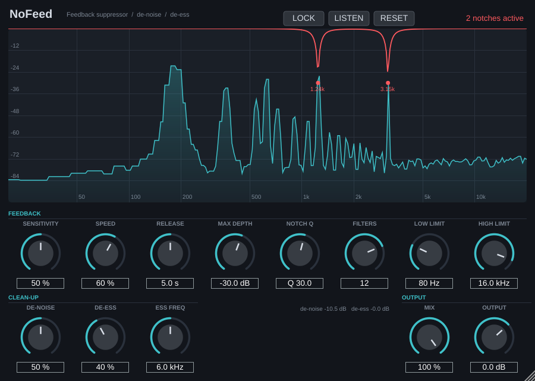

# NoFeed

Real-time **feedback killer** with **de-noise** and **de-ess**, as a **VST3** plugin (Windows, macOS,
Linux), an **Audio Unit** (macOS), and a **standalone app**.



## Install

Download the installer for your system from the
[**latest release**](https://github.com/Jeansenekal-tech/no-feed/releases/latest):

| System | File | What to do |
|---|---|---|
| **Windows** | `NoFeed-x.y.z-Windows-Setup.exe` | Run it and follow the wizard. It installs the VST3 to `C:\Program Files\Common Files\VST3` and adds the standalone app to the Start menu. You can uninstall it from *Settings → Apps*. |
| **macOS** (Apple Silicon and Intel) | `NoFeed-x.y.z-macOS.pkg` | **Right-click → Open** the first time (see the note below). It installs the VST3, the AU and `NoFeed.app`, and you can untick any of them under *Customize*. |
| **Linux** | `NoFeed-x.y.z-Linux-x86_64.tar.gz` | Extract it and run `./install.sh` (current user) or `sudo ./install.sh --system` (all users). Run `./install.sh --uninstall` to remove it. |

After installing, **rescan plugins** in your DAW and look for **NoFeed** (by UniqueAV) under *Restoration*.

> **Unsigned installers:** the installers aren't signed with a paid Microsoft or Apple
> developer certificate, so you'll see one warning the first time you run them.
> On Windows, SmartScreen shows *"Windows protected your PC"*: click **More info → Run anyway**.
> On macOS, Gatekeeper says the package "can't be opened": **right-click → Open → Open**, or go to
> *System Settings → Privacy & Security → Open Anyway*.

## What it does

The chain is **De-Feedback → De-Noise → De-Ess → Mix / Output**.

- **De-Feedback** (zero latency): watches the spectrum for peaks that behave like feedback. Those
  are loud, pure tones that hold a steady pitch, keep building, and have no voice-like harmonics.
  It drops a narrow notch exactly on each one, deepens it while the ringing continues, and lets it
  go slowly once it's gone. It can run up to 16 notches at once.
- **De-Noise** (~10.7 ms latency, reported to the DAW): learns hiss, hum and room tone by itself
  during pauses and turns them down.
- **De-Ess** (zero latency): dips the top end only while an "s" or "sh" is happening.

### Controls

| | |
|---|---|
| **Sensitivity** | How readily something counts as feedback. Lower it if sustained sung notes get notched. |
| **Speed** | How quickly it reacts (~35–260 ms of confirmation). |
| **Release** | How long a notch takes to fade after the feedback stops. |
| **Max Depth** | The deepest cut a single notch may apply. |
| **Notch Q** | Notch width (higher = narrower). |
| **Filters** | The maximum number of notches at once. |
| **Low / High Limit** | The frequency range searched for feedback. |
| **Lock** | Freezes the current notches. Handy after "ringing out" a room. |
| **Listen** | Hear only what is being removed. |
| **Reset** | Clears all notches. |
| **De-Noise / De-Ess / Ess Freq** | The clean-up amounts (0 % = off) and the sibilance frequency. |
| **Mix / Output** | Dry/wet mix and output level. |

The display shows the live input spectrum, and the red curve shows the notches that are currently active.

**Tips:** for live sound, put NoFeed first on the vocal mic channel. To ring out a room, turn the
monitors up until it starts to ring, let NoFeed catch it, press **Lock**, and then back the volume
off a little.

**Known limits:** NoFeed uses signal-processing detection, not a trained neural network. A howl that
sits exactly on a moving voice harmonic can be missed. A dead-straight sung note (no vibrato) at high
Sensitivity can be mistaken for feedback.

## Building from source

You need CMake ≥ 3.22 and a C++17 compiler (Visual Studio 2022, Xcode, or GCC/Clang). JUCE 8 is
downloaded automatically.

```bash
cmake -S . -B build -DCMAKE_BUILD_TYPE=Release
cmake --build build --config Release
```

The output lands in `build/NoFeed_artefacts/Release/`. On Linux, install these first:
`sudo apt install libasound2-dev libx11-dev libxrandr-dev libxinerama-dev libxcursor-dev libxcomposite-dev libxext-dev libfreetype6-dev libfontconfig1-dev`

The DSP test suite (`NoFeedTests`) covers a simulated closed mic→speaker→room loop, a howl on a
recording, false positives on voice alone, de-noise and de-ess.

## Making a release

1. Update the version number in `VERSION`.
2. Commit, then tag the commit and push: `git tag v1.0.1 && git push origin v1.0.1`

GitHub Actions builds the plugin on Windows, macOS and Linux and runs the tests. It then builds each
installer, **installs it on a clean machine** to check it, and publishes all three to a GitHub Release.

## License note

NoFeed is built with [JUCE](https://juce.com). JUCE 8 is available under the AGPLv3, or under a
JUCE licence (there is a free *Personal* tier for small revenue). Pick a licence for this
repository that matches how you plan to distribute it.
